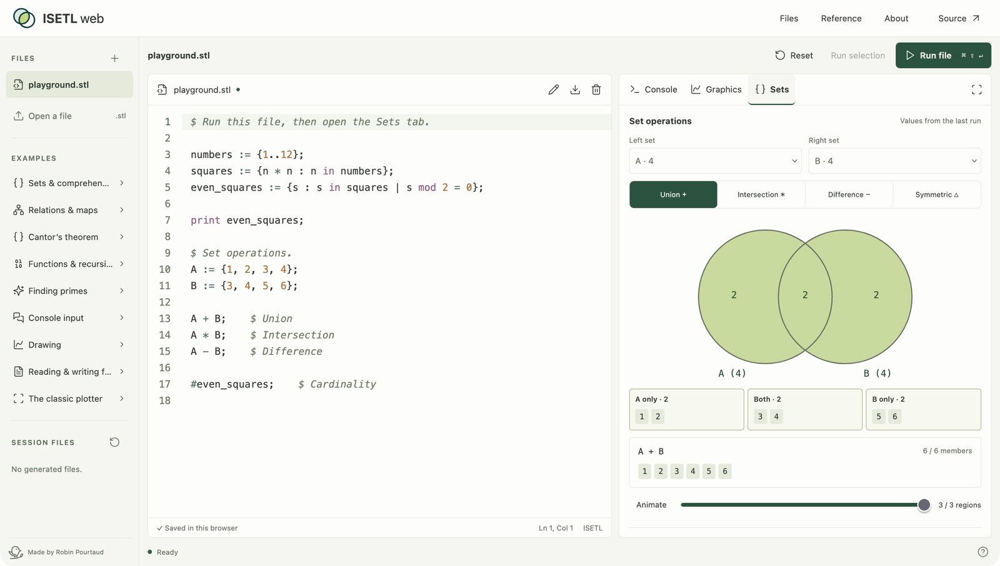
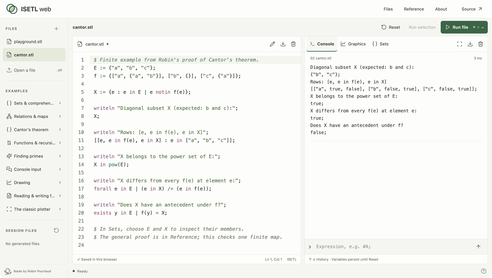
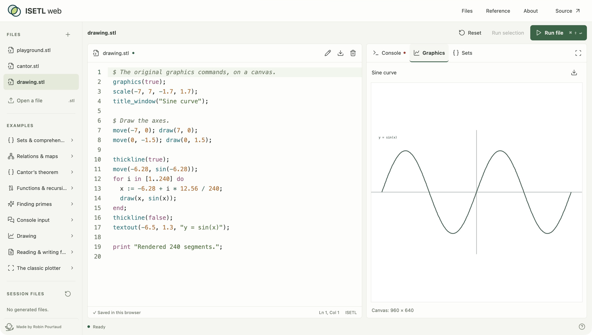

<p align="center"></p>

# ISETL Web

Keeping ISETL alive on the web.

ISETL is a small, interactive language for exploring mathematics with sets, tuples, maps, and functions. This project began as an archive of its sources and executables. ISETL Web makes that archive usable again in a modern browser: write a program, run it, and inspect the result without installing a decades-old application.

The **original C interpreter runs locally through WebAssembly**, with a TypeScript editor, console, graphics, and set inspector around it. No account or execution server.

**[Open ISETL Web](https://isetl.pourtaud.dev)** · [Project story](https://pourtaud.dev/projects/isetl/) · [Contribute](CONTRIBUTING.md) · [Legacy archive](legacy/README.md)



## What you can do

- CodeMirror editor with ISETL highlighting, search, indentation, and selection execution.
- Persistent interpreter sessions, interactive console, `read`/`readf`, and a Stop button.
- Sets, tuples, maps, comprehensions, quantifiers, closures, big integers, and exact fractions.
- Native variable inspector with set membership diagrams and animated union, intersection, difference, and symmetric difference.
- Resizable editor/results split, expandable output, and collapsible files sidebar.
- Canvas graphics and the original interactive plotting libraries, including `donplot.stl`.
- Multiple source files, browser-local autosave, `.stl` import/export, and virtual file I/O.
- Runnable examples, a language guide, and the original manuals.
- A standalone [TypeScript runtime package](packages/runtime/README.md) for other apps.

<details>
<summary>More screenshots</summary>





</details>

## Try a set

```isetl
A := {1..8};
B := {x : x in A | x mod 2 = 0};
A - B;
```

Run this and open **Sets** to compare `A` and `B`. The built-in examples cover recursion, relations, primes, input, drawing, and Cantor’s diagonal construction. The Cantor example illustrates a finite case; it is not a formal proof checker.

## Run it

Use Node.js 22.12 or newer:

```sh
npm ci
npm run dev
```

Open the URL Vite prints, normally `http://127.0.0.1:5173`. Click **Run file** or press **⌘/Ctrl + Shift + Enter** to run the whole file. **Run selection** executes selected code. **⌘/Ctrl + Enter** runs the selection, or the file when nothing is selected. The console also accepts expressions directly.

```sh
npm test         # Interpreter and packaged worker API integration tests
npm run build    # Typecheck, static web app, and reusable runtime package
npm run preview  # Serve the production web build locally
```

The precompiled WebAssembly module is checked in, so Emscripten is **not** required to develop the frontend or use the runtime. The production app is entirely static: deploy `dist/` to a static host, including all generated assets. Relative asset paths support hosting under a subdirectory. Serve it over HTTP(S), not `file://`.

## Repository layout

| Path                                               | Purpose                                                         |
| -------------------------------------------------- | --------------------------------------------------------------- |
| `apps/web/`                                        | TypeScript frontend, editor, console, Canvas renderer, examples |
| `packages/runtime/src/`                            | Public session API, worker protocol, interpreter adapter        |
| `packages/runtime/wasm/`                           | C compatibility bridge for input and graphics                   |
| `packages/runtime/generated/`                      | Checked-in interpreter module, WASM, and bundled libraries      |
| `scripts/`                                         | Reproducible WASM build and runtime packaging                   |
| `tests/`                                           | Real interpreter and public worker API integration tests        |
| `ISETLSRC/`, `ISETLW/`, `ISETL-DOS/`, `ISETL-DOC/` | Preserved historical archive                                    |

## Rebuild WebAssembly

The port is built with **Emscripten 4.0.15**. With that version of `emcc` on your PATH:

```sh
npm run build:wasm
npm test
npm run build
```

Alternatively set `EMCC=/absolute/path/to/emcc`. The script also recognizes a repository-local `.tools/emsdk/upstream/emscripten/emcc` installation. It stages compatibility fixes in `.build/`; it does not rewrite the historical sources. See the [official SDK installation instructions](https://emscripten.org/docs/getting_started/downloads.html) and [Asyncify documentation](https://emscripten.org/docs/porting/asyncify.html).

## Sessions and compatibility

Source files are automatically saved in this browser's local storage. Interpreter variables and files created by programs belong to the current session and are cleared on Reset or reload. Download generated files from **Session files** before resetting. Imported filenames use lowercase and retain the original interpreter's 19-character limit.

The web runtime uses the portable C source in the archive, not the Windows executable. The language and plotting library run locally; OS shell commands and native Windows editor/window features do not. Default `read`/`readf` pauses for console input even when code runs from the editor. The classic plotter accepts keys over its canvas (`c` to connect points, `a` to autoscale, `q` to finish).

Long-running code lives in a worker. Stop terminates that session; Reset starts a new one. A 30-second execution timeout pauses during interactive input. Output is capped at 1 MB per run. Set ordering remains the interpreter's ordering, not numerical sorting.

## Set inspector

Run a program, then select **Sets**. Pick two set variables and an operation. The diagram partitions their members into left-only, shared, and right-only regions; Animate walks through those regions. This illustrates the selected operation on the last completed run, not the execution of individual source lines. The variable table also shows numbers, strings, tuples, and functions.

Inspection comes from the native interpreter, including its equality rules. Snapshots include up to 128 defined, unlocked variables, 80 members per collection, three nested collection levels, and 1,024 visited members overall. Combined results are disabled when either selected set has omitted top-level members. Long scalar labels are abbreviated. Variables persist across files until Reset.

## Contributing

See [CONTRIBUTING.md](CONTRIBUTING.md) for the development workflow and checks.

## Deploy

```sh
npm run build
npm run deploy
```

`wrangler.jsonc` configures Cloudflare Workers Static Assets at `isetl.pourtaud.dev`. Authenticate Wrangler or provide `CLOUDFLARE_ACCOUNT_ID` and `CLOUDFLARE_API_TOKEN` in your environment. No application server or database is deployed. Other static hosts can serve `dist/` unchanged.

## License

The new web frontend, TypeScript runtime layer, and original web-port code are [MIT licensed](LICENSE). The legacy interpreter, its compiled WASM, bundled historical libraries, and original manuals retain their own notices and are excluded from that grant. The original manual permits copying subject to a restriction against sale for profit; those [legacy terms](LICENSE-LEGACY.txt) remain separate from the new code’s MIT license. See [NOTICE.md](NOTICE.md).

## Historical attribution

Original interpreter © Gary Levin, 1986–1990, developed at Clarkson University. The plotting archive includes contributions from Don Muench. Original notices and source files are retained. See [NOTICE.md](NOTICE.md).
